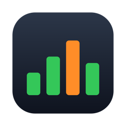
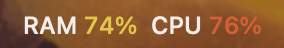
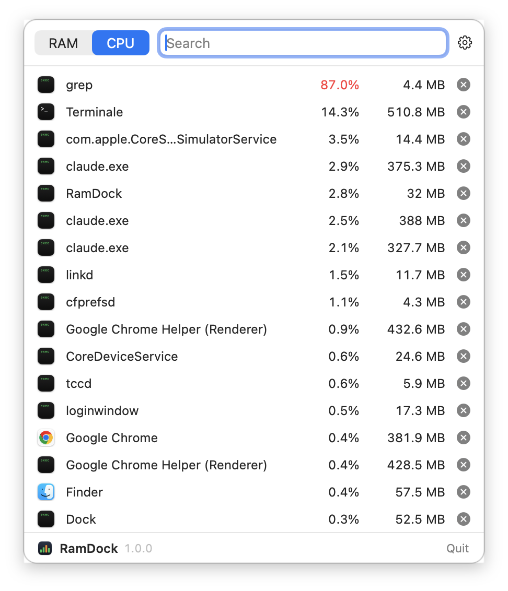
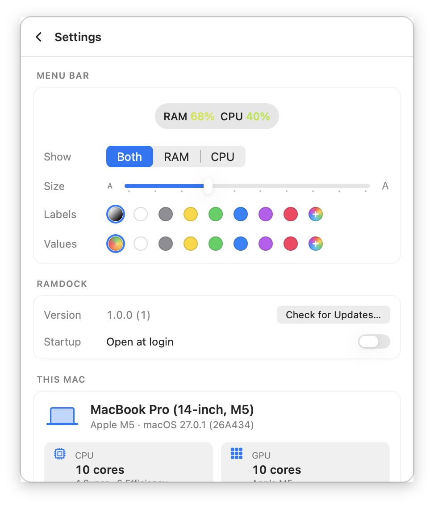

<div align="center">



# RamDock — RAM & CPU monitor for the macOS menu bar

**A free, open-source, featherweight system monitor for Mac. Live RAM and CPU usage in your menu bar, colored from green to red, and every process one click away — with a button to quit the one that's eating your Mac.**

[](https://github.com/simonsruggi/RamDock/releases/latest)
[](https://github.com/simonsruggi/RamDock/releases)
[](https://github.com/simonsruggi/RamDock/releases/latest)
[](https://swift.org)
[](LICENSE)
[](https://github.com/simonsruggi/RamDock/actions/workflows/ci.yml)
[](https://github.com/simonsruggi/RamDock)
[](https://github.com/sponsors/simonsruggi)

```bash
brew install --cask simonsruggi/tap/ramdock
```





</div>

---

## Contents

- [Why RamDock](#why-ramdock)
- [Features](#features)
- [Screenshots](#screenshots)
- [Install](#install)
- [How the numbers are measured](#how-the-numbers-are-measured)
- [How light is it](#how-light-is-it)
- [Privacy](#privacy)
- [Build from source](#build-from-source)
- [FAQ](#faq)
- [License](#license)

## Why RamDock

When the fans spin up or the Mac starts to stutter, the question is always the same: *what is eating my RAM or my CPU right now, and can I kill it?* Activity Monitor answers it, but it's a full window, a dozen columns and three clicks away.

RamDock keeps the answer in the menu bar:

- **Two numbers, always visible.** System RAM and CPU usage, green when things are calm, red when they aren't.
- **One click to the culprit.** Every process with its CPU and memory, sorted by whichever is hurting.
- **One more click to fix it.** Quit the process from the list; force quit it if it doesn't listen.
- **It doesn't become the problem.** A monitor that eats resources defeats its purpose: RamDock is written in plain AppKit and idles at a few megabytes and near-zero CPU.

## Features

- **Live menu bar readout** — `RAM 74%  CPU 23%`, refreshed every 3 seconds, each value colored on a green → yellow → red scale.
- **Process list** — CPU % and memory for every process you own, sorted by RAM or CPU, with app icons.
- **Search** by process name or PID.
- **Quit and Force Quit** — the ✕ on each row sends a normal quit (SIGTERM); ⌥-click or right-click → *Force Quit* sends SIGKILL. Right-click → *Copy PID*.
- **Customizable menu bar** — show RAM and CPU, RAM only or CPU only; text size from 9 to 18 pt; label and value colors from presets or any color you pick; a live preview shows the result as you change it.
- **This Mac** — model, chip, CPU cores (performance and efficiency), GPU cores, memory, free storage, macOS version and uptime.
- **Open at login** and **automatic updates** (Sparkle).
- Native, universal (Apple silicon and Intel), light and dark mode.

## Screenshots

<div align="center">


</div>

## Install

**Homebrew**

```bash
brew install --cask simonsruggi/tap/ramdock
```

**Direct download** — grab `RamDock.zip` from the [latest release](https://github.com/simonsruggi/RamDock/releases/latest), unzip it and drag `RamDock.app` to Applications. The app is signed with a Developer ID and notarized by Apple.

RamDock lives in the menu bar only — there's no Dock icon. Turn on **Settings → Open at login** to have it start with your Mac. Updates are checked automatically; **Settings → Check for Updates…** checks right away.

Requires macOS 14 Sonoma or later.

## How the numbers are measured

| | Source | Matches |
|---|---|---|
| Menu bar RAM | `host_statistics64`: app memory + wired + compressed, over physical memory | Activity Monitor → Memory → *Memory Used* |
| Menu bar CPU | `host_statistics` CPU ticks, averaged over all cores | Activity Monitor → CPU → *User + System* |
| Process CPU | `proc_pid_rusage` user + system time between two samples | Activity Monitor's *% CPU* (100% = one core) |
| Process memory | `proc_pid_rusage` physical footprint | Activity Monitor's *Memory* column |

## How light is it

A resource monitor shouldn't be a resource problem. Measured with `footprint` on an M5 MacBook Pro:

- **~13 MB** of memory at launch, **~27–35 MB** after using the panel.
- **~0.15 s of CPU per minute** with the panel closed — the status item reads two kernel counters every 3 seconds and redraws only when a number changes.
- The process list is sampled **only while the panel is open**; closing it stops sampling and releases the list.

The architecture notes in [PROJECT.md](PROJECT.md) explain the choices, including why RamDock uses a custom panel instead of `NSPopover` (an empty popover alone keeps ~25 MB alive).

## Privacy

RamDock has no account, no analytics and no server. Process and system data is read locally and never leaves your Mac. The only network request is Sparkle's update check against this repository's `appcast.xml`.

## Build from source

```bash
git clone https://github.com/simonsruggi/RamDock.git
cd RamDock
./build-app.sh --install   # builds a universal RamDock.app and copies it to /Applications
```

Swift Package Manager, one dependency (Sparkle). Without a Developer ID the app is signed ad-hoc.

## FAQ

**Why don't I see `kernel_task`, `WindowServer` or other system processes?**
macOS only lets an unprivileged app read the processes of the current user, and those are also the only ones you can quit without administrator rights. The menu bar totals do include the whole system.

**The CPU of a process is above 100%. Is that a bug?**
No — as in Activity Monitor, 100% is one full core, so a process using four cores shows 400%. The menu bar CPU is the average across all cores, so it never exceeds 100%.

**What's the difference between the ✕ and Force Quit?**
The ✕ asks the process to quit (SIGTERM), so apps can save and clean up. Force Quit (⌥-click or right-click) kills it immediately (SIGKILL) — use it when the process ignores the normal quit.

**Why is the RAM percentage so high when I'm not doing much?**
macOS uses free memory for caches on purpose. RamDock reports *Memory Used* the same way Activity Monitor does, which excludes file cache; a high number with green color is fine, red means you're running short.

**Is RamDock a free alternative to iStat Menus or Stats?**
For RAM and CPU, yes: RamDock focuses on those two numbers and on quitting the process behind them, and stays much smaller. If you need network, disk, sensors or battery graphs, those apps cover more.

## License

MIT — see [LICENSE](LICENSE). Issues and pull requests are welcome.

---

<div align="center">

Made with ❤️ by [Simone Ruggiero](https://simoneruggiero.com?utm_source=RamDock&utm_medium=readme)

</div>
